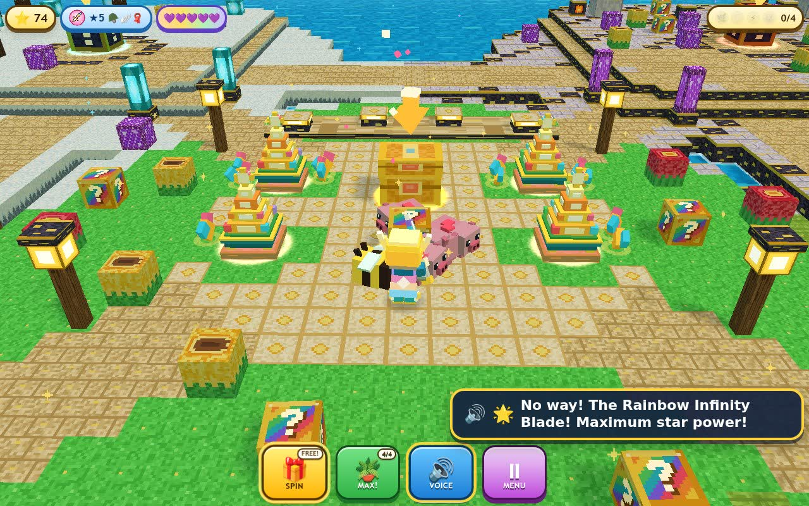

# Lucky Block Titans 3D

**Play Live:** [https://kunruiw1991.github.io/lucky-block-titans/](https://kunruiw1991.github.io/lucky-block-titans/)



**Lucky Block Titans 3D** is a bright, cheerful 3rd-person 3D voxel toy-island adventure crafted specifically for young children (ages 5+). Every block you smash pops out wacky random surprises—from glowing Star Gems, bouncy farm critters, and Magic Flowerpot Seeds to Mythic Armor and towering, goofy Cartoon Titans!

## Highlights

- **One-Tap Kid-Friendly Controls**: Tap anywhere on the island to zoom over, tap any block or critter to smash or pet automatically, and drag with one finger to spin the camera smoothly. Keyboard (`WASD` / `Arrow Keys` + `Space` / `Enter`) works seamlessly on desktop too.
- **Zero Menus, Zero Crafting Grids, Zero Game-Over Screens**: Gear equips straight onto your blocky hero with clear `★1`–`★5` Star Power badges and sparkling shield hearts. If a child wakes up a high-tier Titan early, the Titan lets out a silly belly laugh and gently boings the hero back to the Cozy Star Garden on a **3D Rainbow Spring Cloud**—never a single lost gem!
- **Magic Bonsai Flowerpots**: Plant and upgrade 4 glowing garden pads (`Glow Flowerpot` -> `Crystal Flowerpot` -> `Ultimate Rainbow Star Pot`) that bloom and fountain shiny Star Gems automatically.
- **Mystery Artifact Roulette Chest**: Spin the horizontal picture reel to win and auto-equip iconic voxel weapons—`Sparkle Sword`, `Golden Mega Pickaxe`, `Ocean Trident`, `Vortex Thunder Hammer`, and the `Rainbow Infinity Blade`!
- **4 Goofy Pocket-Biome Titans**: Explore the *Sunny Flower Meadow*, *Crystal Snow Peak*, *Honey & Pumpkin Farm*, and *Golden Bedrock Castle* to wake and bonk the *Mossy Stone Titan*, *Frosty Snow-Wizard Titan*, *Thunder Chief Titan*, and *Bedrock Crusher King* into candy-pinata Trophy fountains!
- **Full English Neural Voiceover + 1-Tap Replay (`VOICE`)**: Includes 68 pre-recorded expressive English voice lines across 3 character voices (Kid Guide, Garden & Chest Fairy, and Silly Cartoon Titans) with automatic `-6 dB` background music ducking, big readable subtitles, and instant 1-tap replay.
- **Lucky Chaos Mode**: Toggle extra-wacky surprise drops anytime from the `MENU` modal or keep exploring in endless Free-Play after collecting all 4 Golden Titan Trophies.

## Run Locally

No bundler, build step, or external CDN is required—everything runs as native ES2022 modules with vendored Three.js (`r170`):

```bash
python3 -m http.server 8080
```

Then open [http://localhost:8080/](http://localhost:8080/) in any modern desktop, tablet, or mobile browser.

## Automated Quality & Kid-UX Verification

```bash
python3 tests/l10n_audit.py     # English-only static + runtime DOM/Canvas audit (0 CJK, 0 Web Speech API)
python3 tests/layout_audit.py   # 5-viewport Kid-UX geometry, touch-target (>=72px) & zero-overlap audit
python3 tests/sim_gates.py      # Gates F1..F10 + 20-seed simulated 5-year-old playthrough & determinism
python3 tests/run_e2e.py        # 46 end-to-end WebGL, audio/voice ducking & gameplay assertions
```
